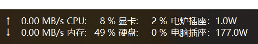

# 米家多设备功率 TrafficMonitor 插件

这是 [`cxhoyo/MijiaPluginForTM`](https://github.com/cxhoyo/MijiaPluginForTM) 的多设备版本。每台米家/酷控智能插座注册为独立的 TrafficMonitor 显示项，通过局域网 miIO 协议读取实时功率。

**主要功能：**
- 🔌 同时监控多台米家设备（配置 v2，最多 128 台，可增删排序）
- 📊 每台设备实时在任务栏显示功率（W）
- 💾 可选启用功率历史记录（按分钟采样，最多保存7天）
- 📈 鼠标悬停提示：显示10分钟/1小时/24小时最大/最小/平均功率
- ⚙️ 设置对话框：逐台配置设备名称、IP、Token，调整共享显示格式
- 🔗 支持断线自动重连

---

## 多设备显示

在 TrafficMonitor 的任务栏设置中关闭“水平排列”后，显示项按两项一列排列：

```text
电脑插座：100W    第三台：50W
空调插座：200W
```

奇数个设备的最后一项固定在新列上行。关闭插件的“显示设备名称标签”后，每项只显示数值，例如 `86.2W`。



每台设备拥有独立的 TrafficMonitor item ID，因此可以单独显示、隐藏、排序和设置颜色。设备改名不会改变 item ID，也不会丢失 TrafficMonitor 中已有的项目设置。

## 配置

插件设置窗口提供：

- 添加、删除、上移和下移设备；
- 为每台设备配置名称、局域网 IP 和 Token；
- 单独测试选中设备的连接；
- 共享设置采集间隔、历史记录、标签、单位和小数位数；
- 清除选中设备或全部设备的历史记录。

设备增删或排序会改变 TrafficMonitor 枚举到的显示项，需要重启 TrafficMonitor。已有设备的名称、IP、Token 和共享显示设置保存后立即应用。

Token 是敏感凭据。插件只在本机配置文件中保存 Token，设置窗口使用密码掩码，不会把 Token 写入日志。

## 从单设备版本迁移

首次加载时，插件会识别原 `MijiaPower.ini` 中一个或多个重复的 `[Device]` 配置块：

1. 在同目录创建 `MijiaPower.ini.legacy.bak`；
2. 按原出现顺序导入全部设备；
3. 将配置写成带稳定 item ID 的多设备格式；
4. 第一台设备继续使用 `MijiaPowerW`，保留原 TrafficMonitor 显示和颜色设置；
5. 其他设备重启后需在 TrafficMonitor 的“显示项目”中启用一次。

迁移和运行时配置位于 TrafficMonitor 传入的插件配置目录。插件不会把配置或 Token 写进源码目录。

## 支持说明

- 插件会通过 `miIO.info` 获取设备型号，并使用**精确型号匹配**选择功率属性
- 当前已知兼容型号：`cuco.plug.v3`、米家智能插座2 蓝牙网关版（`chuangmi.plug.212a01`）
- 米家智能插座2 蓝牙网关版（`chuangmi.plug.212a01`）的功率属性为 `siid=5, piid=6`，原始值除以 `100` 后得到瓦特值
- 非精确匹配型号不会套用米家智能插座2 蓝牙网关版（`chuangmi.plug.212a01`）的映射，避免误读未知型号的属性

---

## 配置说明

首次使用需要配置设备信息：

1. 在 TrafficMonitor 任务栏右键 → **选项**，或直接右键插件显示区域 → **选项**
2. 填写以下内容：
   - **设备 IP**：米家插座的局域网 IP 地址（如 `192.168.1.100`）
   - **Token**：32位十六进制字符串（获取方法见下方）
   - **名称**：设备昵称，显示在提示信息中
3. 点击 **测试连接** 验证配置是否正确
4. 点击 **确定** 保存并生效

### 如何获取 Token

#### 🌟 推荐方案：使用 Xiaomi Cloud Tokens Extractor

最便捷和推荐的方法是使用以下项目，它可以自动从米家云提取所有设备的 Token 和 IP：

**项目地址**: [Xiaomi-cloud-tokens-extractor](https://github.com/PiotrMachowski/Xiaomi-cloud-tokens-extractor)

**使用步骤**：

1. **下载工具**
   - 访问 [Release 页面](https://github.com/PiotrMachowski/Xiaomi-cloud-tokens-extractor/releases)
   - 下载最新版本（Windows 用户下载 `.exe` 文件）

2. **运行提取器**
   ```
   点击双击 .exe 文件运行
   或在命令行中：
   xiaomi_cloud_tokens_extractor.exe
   ```

3. **输入米家账户信息**
   ```
   Username: 你的米家账户（邮箱或手机号）
   Password: 你的米家密码
   Server:   China (中国用户选择此项)
   ```

4. **查看结果**
   - 工具会自动列出所有米家设备
   - 复制你的插座设备的 **IP** 和 **Token**
   ```
   设备名称: 客厅插座
   Model:    cuco.plug.v3
   IP:       192.168.1.100
   Token:    a1b2c3d4e5f6a7b8c9d0e1f2a3b4c5d6
   ```

5. **保存信息**
   - 在记事本或文档中保存好 IP 和 Token
   - ⚠️ Token 是敏感信息，请妥善保管，不要分享给他人

#### 📖 其他获取方法

如果上述方法不可用，也可以尝试：

**方法 B - 使用 Python miio 工具**
```bash
# 安装 python-miio
pip install python-miio

# 提取所有设备的 Token
python -m miio.extract_tokens

# 会显示所有设备的信息
```

运行后会列出所有米家设备的名称、型号、IP 和 Token，复制插座设备的那两项填入插件选项即可。

---

## 常见问题快速解决

| 问题 | 症状 | 解决方案 |
|------|------|---------|
| 连接失败 | 显示"连接失败" | 检查 IP 和 Token 是否正确 |
| 没有显示 | 看不到功率数值 | 确认 DLL 文件在 plugins 目录中 |
| 数据异常 | 显示 0W 或错误值 | 检查设备是否开启，重启插件 |
| Token 失败 | 工具无法提取 | 确保米家账户密码正确，网络正常 |
| 型号不兼容 | 测试连接成功但功率异常 | 先确认 `miIO.info` 返回的型号是否为 `cuco.plug.v3` 或米家智能插座2 蓝牙网关版（`chuangmi.plug.212a01`） |

---

## 高级配置选项

安装完成后，可以在插件选项中调整：

| 选项 | 默认值 | 推荐值 | 说明 |
|------|--------|--------|------|
| 启用历史记录 | 关闭 | 开启 | 记录功率数据用于分析 |
| 显示功率标签 | 开启 | 开启 | 任务栏显示"功率:"文字 |
| 显示 W 单位 | 开启 | 开启 | 数值后显示"W" |
| 采集间隔(秒) | 3 | 3-5 | 越小更新越快，但消耗更多资源 |
| 小数位数 | 1 | 1 | 显示精度（0-2位） |

---

## 安装

1. 完全退出 TrafficMonitor。
2. 将 x64 Release 的 `MijiaPower.dll` 复制到 TrafficMonitor 的 `plugins` 目录。
3. 启动 TrafficMonitor，在插件选项中检查迁移后的设备列表。
4. 在任务栏“显示项目”中启用新增设备，并按需要调整项目顺序和颜色。
5. 设备集合变化后再次重启 TrafficMonitor。

插件通过 UDP `54321` 端口直连设备，电脑和插座必须位于可互通的局域网。当前功率属性沿用上游实现的 `siid=11, piid=2`，已知兼容 `cuco.plug.v3`。

## 构建

需要 Visual Studio 2022 Build Tools，并安装“使用 C++ 的桌面开发”和 Windows SDK：

```powershell
.\compile.ps1 -Configuration Release -Platform x64
```

产物位于 `bin\Release\x64\MijiaPower.dll`。GitHub Actions 也会构建 x64 Release、检查 `TMPluginGetInstance` 导出并上传 DLL artifact。

## 文件说明

| 文件 | 说明 |
|------|------|
| `PluginInterface.h` | TrafficMonitor 插件接口定义 |
| `MiioDevice.h/.cpp` | 纯C++ miIO协议实现（AES-128-CBC + UDP） |
| `PowerHistory.h/.cpp` | 功率历史采样与统计 |
| `PluginConfig.h/.cpp` | 插件配置（INI文件读写） |
| `MijiaPowerPlugin.h/.cpp` | 插件主类（ITMPlugin/IPluginItem实现） |
| `OptionsDlg.h/.cpp` | 设置对话框（纯Win32） |
| `pch.h/.cpp` | 预编译头 |

---

## 配置文件位置

插件配置文件默认保存在 TrafficMonitor 的插件配置目录：
```
%AppData%\TrafficMonitor\plugins\
  MijiaPower.ini          ← 设备信息和选项（多设备格式，带 ConfigVersion）
  MijiaPower_history\
    <设备ID>\YYYY-MM.csv  ← 每台设备各自的按月功率历史（如果启用）
```

说明：
- 每台设备的历史存放在 `MijiaPower_history\<设备ID>\` 子目录下，按月份自动创建 `YYYY-MM.csv`
- CSV 采用追加写入方式；插件启动时只会流式读取覆盖最近 10 分钟和 7 天汇总窗口所需的月份文件，不会整文件载入内存
- 时间列使用用户系统本地时区格式化输出，便于直接查看
- CSV 首行包含中文标题，默认列为 `本地时间,功率(W)`
- 历史记录会在运行中按约 60 秒周期定期保存
- “清除历史”会删除 `MijiaPower_history` 目录下全部月文件

---
- 旧版本（单设备）的 `MijiaPower_history\YYYY-MM.csv` 会在首台设备首次加载时自动迁移到其子目录
- 多设备配置由旧 `MijiaPower.ini` 的 `[Device]` 段自动迁移，原文件保留为 `MijiaPower.ini.legacy.bak`

---

1. 每台设备都通过 UDP 协议（端口 54321）直接通信，**设备必须与电脑在同一局域网**
2. miIO 协议需要正确的 Token，错误的 Token 会导致连接失败
3. 采集间隔不建议设置低于 2 秒，以免对设备造成过多请求
4. 不同型号的插座功率属性可能不同。当前插件支持基于精确型号匹配的属性映射（详见上方兼容设备表）

---

## 兼容的设备

基于原项目 `mijia_plug` 的设备属性定义：

| 属性 | siid | piid | 说明 |
|------|------|------|------|
| 开关 | 2 | 1 | 插座开关状态 |
| 功率 | 11 | 2 | `cuco.plug.v3` 当前功率（W） |
| 功率 | 5 | 6 | 米家智能插座2 蓝牙网关版（`chuangmi.plug.212a01`）当前功率（原始值除以 100 得到 W） |
| 能耗 | 11 | 1 | 累计用电量 |
| 温度 | 12 | 2 | 插座温度 |

已知兼容型号：`cuco.plug.v3`（米家智能插座3）、米家智能插座2 蓝牙网关版（`chuangmi.plug.212a01`）

---

## 开发依赖

插件完全无第三方依赖，所有加密算法（AES-128-CBC、MD5）均为纯 C++ 实现，仅依赖 Windows 系统 API（ws2_32.lib、comctl32.lib）。

---

## 构建与发布

### GitHub Actions

- `Build DLL` 会在任意分支推送时运行，也支持 `pull_request` 和手动触发
- 构建产物包含 `MijiaPower.dll` 和 `MijiaPower.pdb`
- `Release DLL` 会在推送 `v*` 标签时创建 GitHub Release，也支持手动输入 `tag_name` 触发

### 本地编译

- 运行仓库根目录下的 `compile.ps1`
- 或使用 Visual Studio / MSBuild 编译 `Release | x64`
- 默认输出目录为 `bin/Release/x64/`

---

## 参考

- [TrafficMonitor 插件开发指南](https://github.com/zhongyang219/TrafficMonitor/wiki/%E6%8F%92%E4%BB%B6%E5%BC%80%E5%8F%91%E6%8C%87%E5%8D%97)
- [cxhoyo/MijiaPluginForTM](https://github.com/cxhoyo/MijiaPluginForTM)
